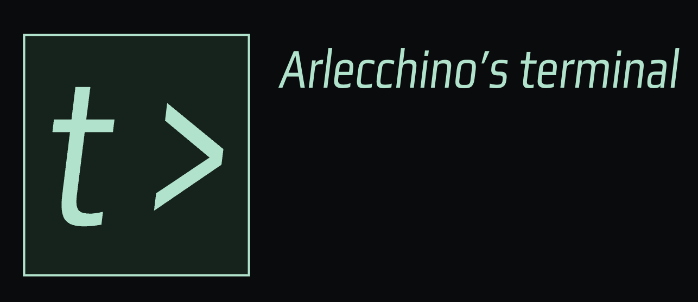
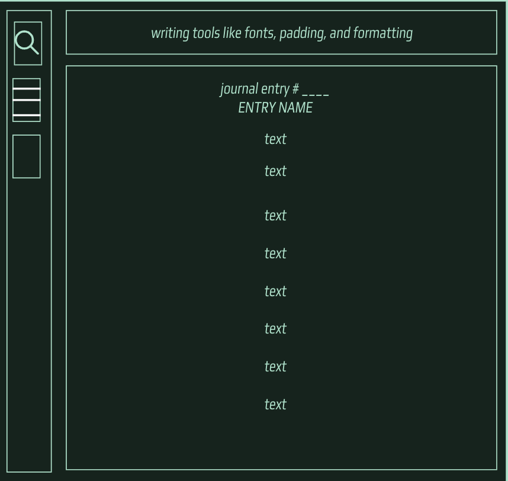

# Terminal by Arlecchino

A private, lightweight writing environment that makes journaling effortless.

**Release candidate for Terminal 1.0.** Terminal saves journal entries to a local SQLite database. Write a title or paragraph, wait for **Saved**, then quit and reopen to continue. Use Archives or title search to return to earlier entries.

## Installation

Get published installers from the [official releases](https://github.com/arlecchinoOPSource/Arlecchino-s-Terminal-Journal/releases). For macOS, open the universal DMG and drag Terminal to Applications. For Windows x64, run the per-user setup executable or use the MSI. A machine missing WebView2 may need a one-time runtime download. See the [installation and signing notes](docs/RELEASE.md) for platform requirements. Until the stable release appears, the candidate is available for testing from source.

## Project documents

- [Product Requirements Document v0.1](docs/PRD-v0.1.md)
- [UI Design System v0.3](docs/UI-DESIGN-SYSTEM-v0.3.md)
- [Accepted development backlog](docs/BACKLOG.md)
- [Architecture and decisions](docs/ARCHITECTURE.md)
- [Development environment](docs/DEVELOPMENT.md)
- [Contribution workflow](CONTRIBUTING.md) and [AI agent instructions](AGENTS.md)

Tracking: [20 ordered issues](https://github.com/arlecchinoOPSource/Arlecchino-s-Terminal-Journal/issues?q=is%3Aissue+sort%3Acreated-asc) · [five milestones](https://github.com/arlecchinoOPSource/Arlecchino-s-Terminal-Journal/milestones) · [Terminal v1.0 project board](https://github.com/users/arlecchinoOPSource/projects/1).

## Technology

Tauri 2, React, TypeScript, Vite, Tiptap, and local SQLite. Distribution is planned through GitHub Releases after cross-platform testing. Supported OS versions and installer trust requirements will be verified before release.

## Design reference

The image above is the original layout reference. The current [v0.3 "Terminal 84" design](docs/UI-DESIGN-SYSTEM-v0.3.md) keeps the left menu and right writing area and gives them a retro-futuristic console treatment: green-black framed panels, a phosphor-green accent, a striped Orbitron wordmark, and a calm writing page.

## Privacy and data ownership

Terminal keeps writing on the device without accounts, analytics, or cloud sync. The database relies on operating-system permissions and disk encryption. Exported JSON backups, HTML and text files contain readable writing. Keep those files in a location you control. Uninstalling the app leaves the journal in the operating system’s application-data folder. See [storage locations](docs/RELEASE.md#clean-machine-checklist).

## Development

Open this folder in VS Code and run `npm run dev` in its terminal, or select **Terminal → Run Task → Terminal: Run desktop preview**. Test the title, multiline writing, selection, copy/paste, and undo/redo. Use synthetic writing to test autosave, reopen, export and restore. See [the development guide](docs/DEVELOPMENT.md) for setup, checks, and platform limitations. Work through authorized backlog tasks in order.

## License

[MIT](LICENSE) — Copyright 2026 Arlecchino.
